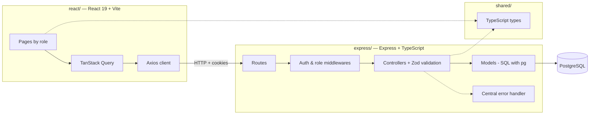
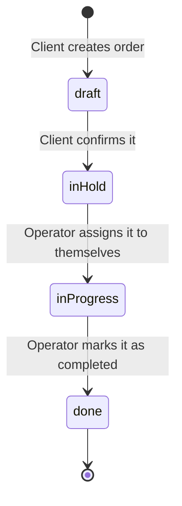
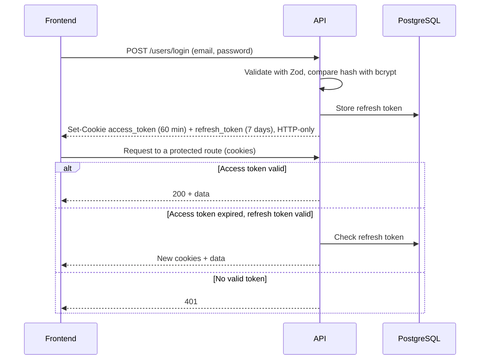

# Pawn-to-Pawn

> Full-stack TypeScript application for managing manufacturing orders, with a layered Express REST API, JWT authentication with refresh tokens and role-based access control.


Final project of my Higher Vocational Training in Web Application Development (DAW). Clients place orders for configurable products; operators pick them up, prepare them and mark them as completed; administrators manage the catalogue (products, materials and machines) and the users.

<!-- TODO: add 1–2 screenshots here, e.g.  -->

## Table of contents

- [Highlights](#highlights)
- [Architecture](#architecture)
- [Order workflow](#order-workflow)
- [Authentication](#authentication)
- [Roles and permissions](#roles-and-permissions)
- [API reference](#api-reference)
- [Tech stack](#tech-stack)
- [Getting started](#getting-started)
- [Project structure](#project-structure)
- [Roadmap](#roadmap)

## Highlights

- **Layered REST API** with Express: routes → middlewares → controllers → models, using raw SQL through `pg` (no ORM).
- **Input validation with Zod** on every write endpoint.
- **Centralised error handling** with custom error classes (`ClientError`, `UnauthorizedError`, …) mapped to HTTP status codes in a single handler.
- **JWT authentication in HTTP-only cookies**: short-lived access token plus a refresh token persisted in the database, with transparent renewal in the auth middleware.
- **Role-based authorisation** (client, operator, admin) implemented as composable Express middlewares.
- **Shared types package** (`@pawn-to-pawn/shared`) consumed by both backend and frontend through npm workspaces, so API contracts are type-checked end to end.
- **Dockerised stack** (PostgreSQL + API + Nginx-served frontend) with health checks and a Makefile for setup, logs and database backups.

## Architecture



## Order workflow



- The order price is calculated on the server (`quantity × product price`), never trusted from the client.
- Transitions are validated in the controller: for example, an order can only be completed if it is `inProgress`.

## Authentication



Passwords are hashed with bcrypt and never returned by the API. Cookies are `httpOnly`, and `secure` in production.

## Roles and permissions

| Role | Can do |
|------|--------|
| **Client** | Register, log in, create orders, confirm them and see their own orders. Read the product catalogue. |
| **Operator** | Everything a client can, plus: see pending orders, take an order, complete it, list clients and create products. |
| **Admin** | Everything an operator can, plus: manage users (list, promote to operator, delete), list all orders and create materials and machines. |

An admin user is created automatically on first start-up from the `ADMIN_*` environment variables.

## API reference

All routes except register, login and logout require authentication cookies. The minimum role is shown for each one (higher roles inherit access).

### Users — `/users`

| Method | Path | Role | Description |
|--------|------|------|-------------|
| POST | `/users/register` | public | Create a client account |
| POST | `/users/login` | public | Log in and receive auth cookies |
| POST | `/users/logout` | public | Clear the auth cookies |
| GET | `/users/me` | client | Current user |
| GET | `/users/clients` | operator | List clients |
| GET | `/users` | admin | List all users |
| GET | `/users/operators` | admin | List operators |
| PATCH | `/users/:id` | admin | Promote a user to operator |
| DELETE | `/users/:id` | admin | Delete a user |

### Orders — `/orders`

| Method | Path | Role | Description |
|--------|------|------|-------------|
| POST | `/orders` | client | Create an order (`draft`) |
| GET | `/orders/all/me` | client | My orders |
| GET | `/orders/me/:id` | client | One of my orders |
| PATCH | `/orders/set/pending/:id` | client | Confirm an order (`draft` → `inHold`) |
| GET | `/orders/pending` | operator | Orders waiting for an operator |
| GET | `/orders/preparation` | operator | The order the operator is currently preparing |
| GET | `/orders/operator/orders/:id` | operator | Orders handled by an operator |
| PATCH | `/orders/set/operator/:id` | operator | Take an order (`inHold` → `inProgress`) |
| PATCH | `/orders/set/complete/:id` | operator | Complete an order (`inProgress` → `done`) |
| GET | `/orders` | admin | All orders |
| GET | `/orders/:id` | admin | Order by id |

### Catalogue — `/products`, `/materials`, `/machines`

| Method | Path | Role | Description |
|--------|------|------|-------------|
| GET | `/products`, `/products/:id` | client | List / get products |
| GET | `/products/material/:id` | client | Products that use a material |
| POST | `/products` | operator | Create a product |
| GET | `/materials`, `/materials/:id` | client | List / get materials |
| POST | `/materials` | admin | Create a material |
| GET | `/machines`, `/machines/:id` | client | List / get machines |
| POST | `/machines` | admin | Create a machine |

### Health

`GET /health` returns `{ "status": "ok", "timestamp": "..." }`.

Example requests for every endpoint are available as `.http` files in [`express/src/api_requests/`](express/src/api_requests/).

## Tech stack

**Backend:** Node.js, Express 4, TypeScript (strict), PostgreSQL with `pg`, Zod, jsonwebtoken, bcrypt, cookie-parser, CORS.

**Frontend:** React 19, React Router 7, TanStack Query 5, axios, styled-components, Radix UI, Vite.

**Tooling and infrastructure:** npm workspaces, Docker and Docker Compose, Nginx, Makefile, Vercel, Supabase (managed PostgreSQL).

## Getting started

### With Docker (recommended)

Requirements: Docker with Docker Compose, and `make`.

```bash
git clone https://github.com/JoseLoder/Pawn-to-Pawn.git
cd Pawn-to-Pawn
make setup   # creates .env from .env.example and installs dependencies
# edit .env: at least SECRET_JWT_KEY, REFRESH_JWT_KEY and the passwords
make run     # builds and starts PostgreSQL, the API and the frontend
```

- Frontend: http://localhost
- API: http://localhost:3000 (health check at `/health`)

Run `make help` to see every available command (`logs`, `db-backup`, `db-restore`, `health`, …).

### Without Docker

Requirements: Node.js 20+ and a PostgreSQL database.

```bash
# Backend
cd express
npm install
cp ../.env.example .env   # set DATABASE_URL and the rest of the variables
npm run dev               # http://localhost:3000

# Frontend (in another terminal)
cd react
npm install
npm run dev               # http://localhost:5173
```

### Environment variables

| Variable | Description |
|----------|-------------|
| `DATABASE_URL` | PostgreSQL connection string |
| `SECRET_JWT_KEY` | Secret used to sign access tokens |
| `REFRESH_JWT_KEY` | Secret used to sign refresh tokens |
| `FRONTEND_URL` | Allowed CORS origin (no trailing slash) |
| `PORT` | API port (default `3000`) |
| `NODE_ENV` | `development` or `production` |
| `ADMIN_ID_NUMBER`, `ADMIN_NAME`, `ADMIN_EMAIL`, `ADMIN_DEFAULT_PASSWORD` | Initial admin user |
| `VITE_API_URL` | API URL used by the frontend |

Never commit real values: `.env` files are ignored by Git and `.env.example` only contains placeholders.

## Project structure

```
.
├── express/                # REST API
│   └── src/
│       ├── index.ts        # App setup, routes and start-up
│       ├── routes/         # Endpoint definitions per entity
│       ├── middlewares/    # Authentication and role checks
│       ├── controllers/    # Request handling and business rules
│       ├── schema/         # Zod validation schemas
│       ├── models/         # SQL queries with pg
│       ├── errors/         # Custom error classes and central handler
│       ├── database/       # Connection pool and admin bootstrap
│       └── api_requests/   # .http example requests
├── react/                  # Frontend (pages for client, operator and admin)
├── shared/                 # Types shared by backend and frontend
├── database/init.sql       # Schema for the local PostgreSQL container
├── docker-compose.yml
└── Makefile
```

## Roadmap

Planned improvements:

- [ ] Integration tests with Vitest and Supertest (auth, roles and order workflow)
- [ ] CI with GitHub Actions (lint, type-check and tests on every push)
- [ ] Fail fast at start-up when required secrets are missing
- [ ] Revoke the refresh token in the database on logout
- [ ] OpenAPI / Swagger documentation
- [ ] Build on deploy instead of committing compiled output

## Author

**José Miguel Martín** — Backend / Full-Stack Developer (Node.js · TypeScript)

- Portfolio: https://joseloder.github.io/Curriculum-Vitae/
- GitHub: [@JoseLoder](https://github.com/JoseLoder)
